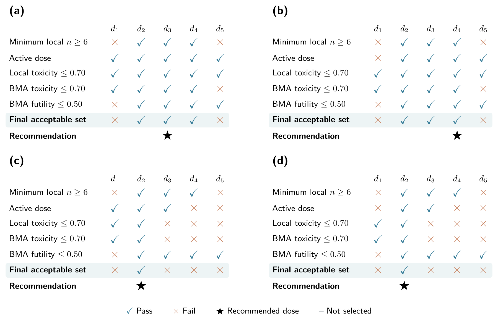
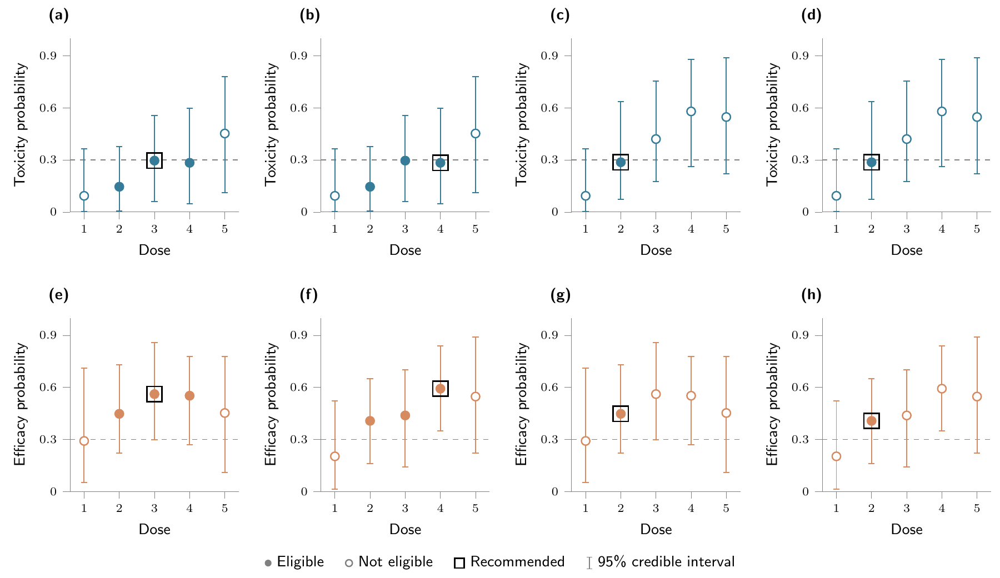

# BMA-BOIN-ET

Endpoint-specific Bayesian partition model averaging for efficacy-toxicity
basket dose finding.

## Install

```r
install.packages("remotes")
remotes::install_github("haohaostats/BMA-BOIN-ET")
library(BMABOINET)
```

## Manuscript example

The Chapter 4 example contains four baskets, five ordered doses, and 24
patients per basket. The counts are constructed to illustrate different
sharing patterns for toxicity and efficacy.

```r
design <- setup_design()
fit <- update_trial(design, example_manuscript_data())
select_od(fit)
```

### Observed data

<details>
<summary>Table 7. View the basket-dose counts</summary>

| Basket | Dose | Patients | Toxicity events | Efficacy events |
|:--:|:--:|--:|--:|--:|
| 1 | d1 | 3 | 0 | 1 |
| 1 | d2 | 6 | 0 | 3 |
| 1 | d3 | 6 | 1 | 4 |
| 1 | d4 | 6 | 1 | 3 |
| 1 | d5 | 3 | 1 | 1 |
| 2 | d1 | 3 | 0 | 0 |
| 2 | d2 | 6 | 0 | 2 |
| 2 | d3 | 6 | 1 | 2 |
| 2 | d4 | 6 | 1 | 4 |
| 2 | d5 | 3 | 1 | 2 |
| 3 | d1 | 3 | 0 | 1 |
| 3 | d2 | 6 | 2 | 3 |
| 3 | d3 | 6 | 3 | 4 |
| 3 | d4 | 6 | 4 | 3 |
| 3 | d5 | 3 | 2 | 1 |
| 4 | d1 | 3 | 0 | 0 |
| 4 | d2 | 6 | 2 | 2 |
| 4 | d3 | 6 | 3 | 2 |
| 4 | d4 | 6 | 4 | 4 |
| 4 | d5 | 3 | 2 | 2 |

Each basket includes 24 patients. Toxicity and efficacy events may occur in
the same patient.

</details>

### Dose screening



**Figure 6.** Panels (a)–(d) show baskets 1–4. Checks mark satisfied
criteria; stars identify the final recommendations. The final candidate set
is the intersection of the sample-size, active-dose, toxicity, and futility
criteria.

### Posterior assessment



**Figure 7.** Columns show baskets 1–4; the top and bottom rows show toxicity
and efficacy. Points and whiskers represent posterior means and 95% credible
intervals. Filled points are eligible doses, and black squares mark the
recommendations. Dashed lines indicate the reference probability of 0.30.

### Final recommendations

**Table 8.** Recommendations in the manuscript's five-method comparison.
The example above reproduces the **BMA-BOIN-ET** row.

| Method | Basket 1 | Basket 2 | Basket 3 | Basket 4 |
|:--|:--:|:--:|:--:|:--:|
| **BMA-BOIN-ET** | **d3** | **d4** | **d2** | **d2** |
| BOIN-ETB | d3 | d4 | d1 | d2 |
| Ind-BOIN-ET | d3 | d4 | d1 | d2 |
| Ind-EffTox | d3 | d4 | d1 | None |
| Hier-EffTox | d3 | d4 | d2 | None |

None indicates that no dose met the method's final selection rules.

## Prospective workflow

```r
design <- setup_design(
  basket_names = paste0("Basket ", 1:4), dose_levels = 1:5,
  target_tox = 0.30, efficacy_null = 0.30, efficacy_alt = 0.50,
  cohort_size = 3, max_sample = 24
)
get_boundaries(design)
fit <- update_trial(design, example_manuscript_data(), current_dose = rep(3, 4))
recommend_dose(fit)
borrowing_diagnostics(fit)
plot_borrowing(fit, endpoint = "toxicity", type = "coclustering", dose = 3)
select_od(fit)
```

Provide cumulative `basket`, `dose`, `n`, `tox`, and `eff` counts. At subsequent
reviews, pass `previous_analysis = fit` and the actual `current_dose` when it
differs from the previous recommendation. This preserves irreversible
elimination and closure. Archive the design before enrollment. Maximum sample
sizes are validated; stop enrollment when a basket reaches its planned total.

## Locked method

| Component | Implementation |
|:--|:--|
| Sharing | Exact partition averaging separately for each endpoint and dose |
| Prior | Beta(1,1); uniform number of groups, then uniform partitions within each group count |
| Permanent toxicity elimination | Local tail probability greater than 0.95, after at least 3 local patients; removes that dose and higher doses |
| Permanent futility elimination | Both local and BMA futility probabilities greater than 0.50, after at least 3 local patients |
| Allocation | Local or BMA toxicity action takes priority; BOIN-ET interval decisions and BMA efficacy ranking |
| Lowest-dose toxicity action | Closes the basket and deactivates all doses |
| Final selection | Active dose, at least 6 local patients, local and BMA toxicity tails at most 0.70, BMA futility at most 0.50 |
| Final ranking | Local-sample-weighted isotonic toxicity, utility 40 - 40 pT + 60 pE; ties use lower toxicity then lower dose |

For four baskets, all 15 partitions are enumerated. The basket set remains
fixed after closure. Exact enumeration scales with the Bell number and can
become expensive for larger basket counts. Posterior tails use the full beta
mixture, not a beta approximation fitted to its mean.

## Shiny application

The Shiny application is deployed separately from the public package.
`run_app()` opens the existing hosted URL; inspect the software name and version
in its audit panel before use. Installing this package does not update the
hosted application. The private application source is not included here.
