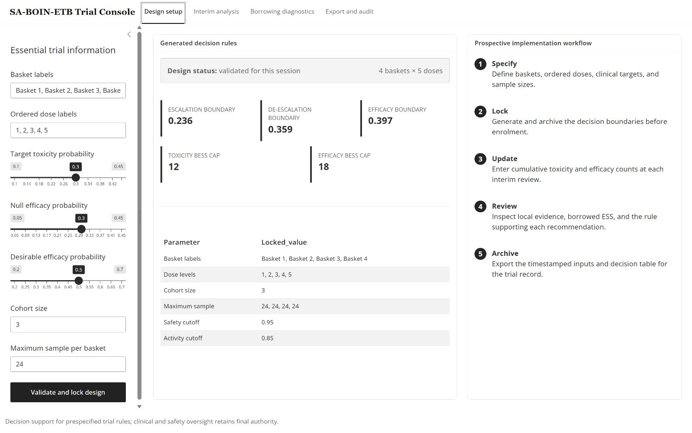
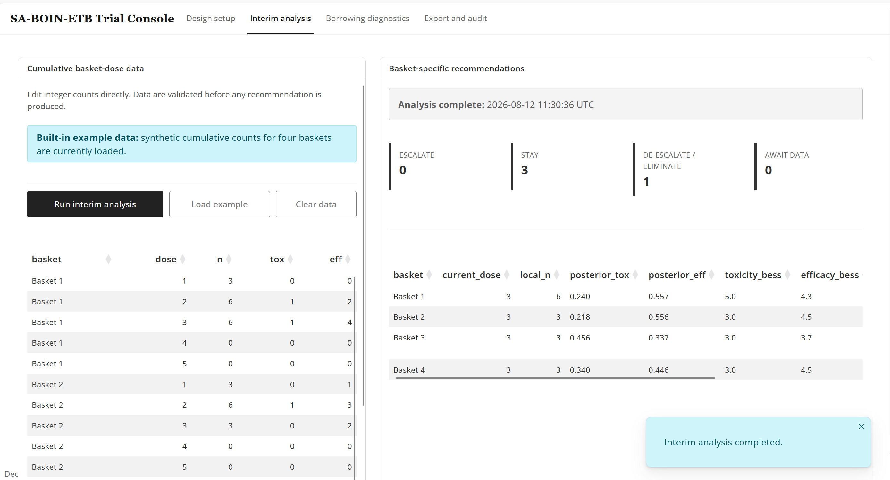
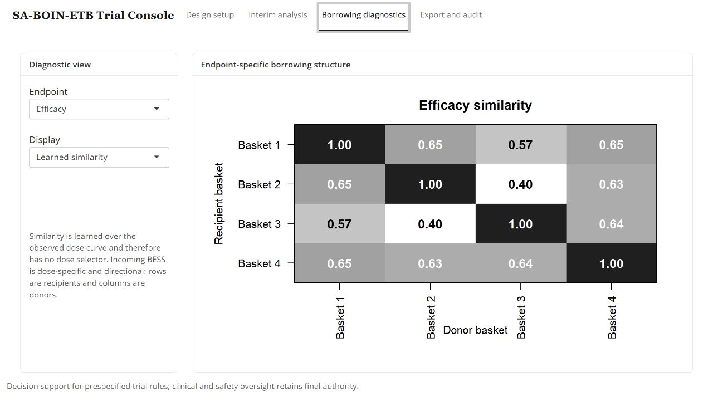

<h1 align="center">SAboinETB</h1>

<p align="center">
  <strong>Similarity-adaptive dose optimization for basket trials with joint toxicity and efficacy endpoints</strong>
</p>

<p align="center">
  Plan the design, enter cumulative interim data, review basket-specific recommendations,
  inspect borrowing, and archive an auditable decision record.
</p>

<p align="center">
  <a href="https://github.com/haohaostats/SAboinETB/releases/latest"></a>
  
  <a href="https://www.gnu.org/licenses/gpl-3.0"></a>
</p>

<p align="center">
  <a href="#quick-start"><strong>Quick start</strong></a> ·
  <a href="https://01a03253-f738-56f5-30c7-6829683c4a56.share.connect.posit.cloud/"><strong>Web app</strong></a> ·
  <a href="#r-workflow"><strong>R workflow</strong></a> ·
  <a href="#what-the-output-means"><strong>Output guide</strong></a>
</p>

---

`SAboinETB` implements the prospective SA-BOIN-ETB workflow for a new basket
dose-optimization trial. The package and hosted web application use the same
versioned analysis engine, so the graphical and programmatic interfaces return
the same recommendations.

| Design task | What the software provides |
|:--|:--|
| Prespecify | Ordered doses, basket labels, clinical targets, cohort size, and maximum sample size |
| Update | Validated cumulative toxicity and efficacy counts at every interim review |
| Decide | Safety-gated exploration, de-escalation, elimination, and utility-based allocation |
| Diagnose | Endpoint-specific learned similarity, donor weights, and borrowed effective sample size (BESS) |
| Complete | Final admissibility assessment and isotonic-regression optimal-dose selection |
| Archive | Timestamped inputs, locked rules, recommendations, diagnostics, and final selections |

The public interface intentionally asks for only clinically interpretable trial
inputs.

## Quick start

### 1. Install the stable release

```r
install.packages("remotes")
remotes::install_github("haohaostats/SAboinETB@v1.0.1")
```

### 2. Open the hosted trial console

[Launch the SA-BOIN-ETB web application](https://01a03253-f738-56f5-30c7-6829683c4a56.share.connect.posit.cloud/),
or open the same URL from R:

```r
SAboinETB::run_app()
```

The hosted application starts with a synthetic example. Select **Load
example**, then **Run interim analysis** to inspect a complete workflow before
entering trial data. The web interface is deployed separately; its source code
is not included in this public R-package repository.

## Hosted web application

**Open the application:**
[SA-BOIN-ETB Trial Console](https://01a03253-f738-56f5-30c7-6829683c4a56.share.connect.posit.cloud/)

### Step 1 — Specify and lock the design

Enter the basket and ordered-dose labels, target toxicity probability, null and
desirable efficacy probabilities, cohort size, and maximum sample size. Select
**Validate and lock design** to generate the prespecified decision boundaries.



### Step 2 — Enter cumulative interim data

At each scheduled review, enter the cumulative number treated (`n`), toxicity
events (`tox`), and efficacy events (`eff`) for every basket-dose combination.
The table checks integer counts, event totals, basket labels, dose labels, and
maximum sample sizes before producing a recommendation.

Select **Load example** for a guided demonstration or **Clear data** before
entering trial-specific counts. Select **Run interim analysis** only after at
least one patient has been entered.



### Step 3 — Review recommendations and borrowing

The recommendation panel separates escalation, staying, de-escalation or
elimination, and baskets awaiting data. The diagnostics workspace shows learned
toxicity or efficacy similarity and dose-specific BESS. Rows are recipient
baskets and columns are donor baskets.



### Step 4 — Export the trial record

Use **Export and audit** to retain the locked design, cumulative inputs,
recommendations, supporting posterior summaries, borrowing diagnostics, and
timestamp. The software provides decision support; protocol-defined clinical
review and safety oversight retain final authority.

## R workflow

The same workflow is available without the graphical interface.

```r
library(SAboinETB)

design <- setup_design(
  basket_names = paste0("Basket ", 1:4),
  dose_levels = 1:5,
  target_tox = 0.30,
  efficacy_null = 0.30,
  efficacy_alt = 0.50,
  cohort_size = 3,
  max_sample = 24
)

# Inspect the locked BOIN boundaries before enrollment.
get_boundaries(design)

# Start with the supplied synthetic cumulative data.
analysis_1 <- update_trial(
  design,
  example_interim_data(),
  current_dose = rep(3, 4)
)

recommend_dose(analysis_1)
borrowing_diagnostics(analysis_1)
select_od(analysis_1)
```

At the next review, pass the preceding analysis so irreversible eliminations
and the prospective dose trajectory are retained:

```r
analysis_2 <- update_trial(
  design,
  next_cumulative_data,
  previous_analysis = analysis_1
)
```

## What the output means

| Output | Interpretation |
|:--|:--|
| `current_dose` | Dose currently assigned in the basket |
| `frontier_dose` | Highest dose explored in that basket |
| `recommended_dose` | Dose recommended for the next cohort |
| `posterior_tox`, `posterior_eff` | Borrowing-adjusted posterior means at the current dose |
| `toxicity_bess`, `efficacy_bess` | Incoming borrowed effective sample size at the current dose |
| `frontier_gate` | Whether local toxicity evidence permits extending the exploration frontier |
| `action` | Escalate, stay, de-escalate, or close the basket |
| `reason` | Prespecified rule supporting the recommendation |

Every recommendation is constrained to the post-elimination active set.
De-escalation selects the highest active lower dose, and utility reassignment
uses only previously tried, active, locally toxicity-admissible doses. If no
such dose remains, the basket is closed rather than returning an inactive or
locally inadmissible dose.

## Data format

Interim data are cumulative and contain one row per observed basket-dose
combination:

```r
data.frame(
  basket = c("Basket 1", "Basket 1", "Basket 2"),
  dose   = c(1, 2, 1),
  n      = c(3, 6, 3),
  tox    = c(0, 1, 0),
  eff    = c(1, 3, 1)
)
```

Event counts cannot exceed `n`; all counts must be non-negative integers. Rows
for unobserved combinations may be omitted in R and are represented by zero in
the web table.

## Documentation

- Run `vignette("trial-implementation", package = "SAboinETB")` for the
  prospective implementation guide.
- Run `help(package = "SAboinETB")` for the function index.
- Use `?setup_design`, `?update_trial`, and `?select_od` for function-level help.

## Citation and support

Cite the versioned software release used for the analysis and report questions
or problems through the
[GitHub issue tracker](https://github.com/haohaostats/SAboinETB/issues).
